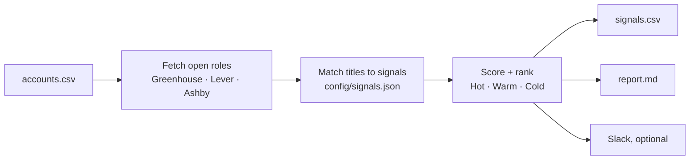

# Buying-Signal Tracker

A small Python tool that checks your target accounts' public job boards and ranks them by **buying signals**. If a company is hiring a Head of Data and three senior data engineers, it's probably investing in its data platform right now, so it's a good time to reach out.

It outputs a ranked CSV (ready for a CRM or spreadsheet), a readable report, and can post the top accounts to Slack every Monday.

Built by **Madan Gopal Koushik**, Senior Enterprise Account Executive (data infrastructure, cloud, SaaS, cybersecurity), with AI coding tools. It's the code version of my [AI outbound workflow](https://github.com/Madangk/ai-outbound-workflow).

---

## Try it in 10 seconds

You need [Python 3.9+](https://www.python.org/downloads/). Nothing else to install.

```bash
git clone https://github.com/Madangk/buying-signal-tracker
cd buying-signal-tracker
python track.py --demo
```

Demo mode uses saved sample data for **fictional** companies, so it works offline. Output:

```
Checking Northwind Payments... 7 open roles, 5 relevant, Hot
Checking Bluepeak Lending... 6 open roles, 3 relevant, Warm
Checking Kestrel Commerce... 5 open roles, 4 relevant, Warm
...
Saved output/signals.csv and output/report.md
```

| # | Account | Status | Score | Why reach out now |
|---|---|---|---|---|
| 1 | Northwind Payments | 🔥 Hot | 22.5 | Data leadership hire: 'Head of Data Engineering', plus 4 more relevant roles. |
| 2 | Bluepeak Lending | 🟡 Warm | 10.5 | Security hiring: 'Senior Security Engineer', plus 2 more relevant roles. |
| 3 | Kestrel Commerce | 🟡 Warm | 10 | AI / ML build-out: 'Senior Machine Learning Engineer', plus 3 more relevant roles. |

Full sample: [`examples/sample-output/report.md`](examples/sample-output/report.md) and [`signals.csv`](examples/sample-output/signals.csv).

## Use it on your own accounts

1. Copy `accounts.example.csv` to `accounts.csv` and list your accounts:

   ```csv
   company,job_board,board_token,tier,owner
   Example Fintech,greenhouse,examplefintech,1,Madan
   ```

2. Find each company's **job board and token** from its careers page link:

   | If the careers link looks like... | job_board | board_token |
   |---|---|---|
   | `boards.greenhouse.io/acme` or `job-boards.greenhouse.io/acme` | `greenhouse` | `acme` |
   | `jobs.lever.co/acme` | `lever` | `acme` |
   | `jobs.ashbyhq.com/acme` | `ashby` | `acme` |

3. Run it:

   ```bash
   python track.py
   ```

Companies using other careers sites (Workday, in-house pages) aren't supported yet. They show up as "Error" with a reason, and the run continues.

## How the scoring works



- Each job title is matched to **one** signal (the highest-weight one), using whole-word keywords:

  | Signal | Weight | Example titles |
  |---|---|---|
  | Data leadership hire | 5 | Head of Data, Director of Analytics |
  | Data platform hiring | 3 | Data Engineer, Analytics Engineer, Kafka |
  | Security hiring | 3 | Security Engineer, Cloud Security Architect |
  | AI / ML build-out | 2 | ML Engineer, MLOps |
  | Platform / cloud scaling | 2 | SRE, Platform Engineer, DevOps |

- Senior titles (Senior, Staff, Lead, Head, Director...) score **1.5x**.
- Only roles posted in the last **60 days** count.
- Account score = the sum of matching roles. **Hot** is 15 or more, **Warm** is 6 or more.

Everything is editable in [`config/signals.json`](config/signals.json), so you can tune it to what you sell (for example, add "PKI" and "HSM" for a cybersecurity product).

## Run it automatically every week (optional)

The repo includes a GitHub Actions workflow ([`.github/workflows/weekly-signals.yml`](.github/workflows/weekly-signals.yml)) that runs every Monday at 8:00 IST:

1. Add your `accounts.csv` to the repo.
2. Optional: in **Settings → Secrets and variables → Actions**, add `SLACK_WEBHOOK_URL` (a [Slack incoming webhook](https://api.slack.com/messaging/webhooks)) to get the top accounts in a Slack channel.
3. Each week's report is saved under the **Actions** tab as a download. You can also run it by hand with **Run workflow**.

## Project structure

| Path | What it does |
|---|---|
| `track.py` | Entry point: `python track.py --help` |
| `signal_tracker/sources.py` | Fetches roles from Greenhouse, Lever and Ashby public APIs and normalises them |
| `signal_tracker/scoring.py` | Keyword matching, seniority boost, recency filter, account scoring |
| `signal_tracker/report.py` | CSV, Markdown report and Slack message |
| `signal_tracker/cli.py` | Command-line options and the main run |
| `config/signals.json` | Signals, keywords, weights and thresholds |
| `examples/demo/` | Sample job-board responses for fictional companies |
| `tests/` | Unit and end-to-end tests: `python -m unittest discover tests` |

Standard library only: no packages to install, nothing to break.

## Good to know

- It uses **public** job-board endpoints that companies publish for their own careers pages. No login, no scraping of personal data, and a short pause between requests.
- Hiring is a signal, not proof of buying intent. Use it to prioritise and to open with something relevant, then qualify in discovery ([MEDDPICC deal kit](https://github.com/Madangk/meddpicc-deal-kit)).

## Related

- [ai-outbound-workflow](https://github.com/Madangk/ai-outbound-workflow): signal-based outbound with HubSpot, Clay, Claude and Slack
- [account-research-agent](https://github.com/Madangk/account-research-agent): one-page account briefs with Claude
- [cloud-roi-calculator](https://github.com/Madangk/cloud-roi-calculator): live ROI and build-vs-buy calculator
- [meddpicc-deal-kit](https://github.com/Madangk/meddpicc-deal-kit) · [enterprise-sales-playbook](https://github.com/Madangk/enterprise-sales-playbook)

📫 [Connect with me on LinkedIn](https://www.linkedin.com/in/madankoushik/) · 🌐 [Portfolio](https://madangk.github.io/madankoushikportfolio/)
